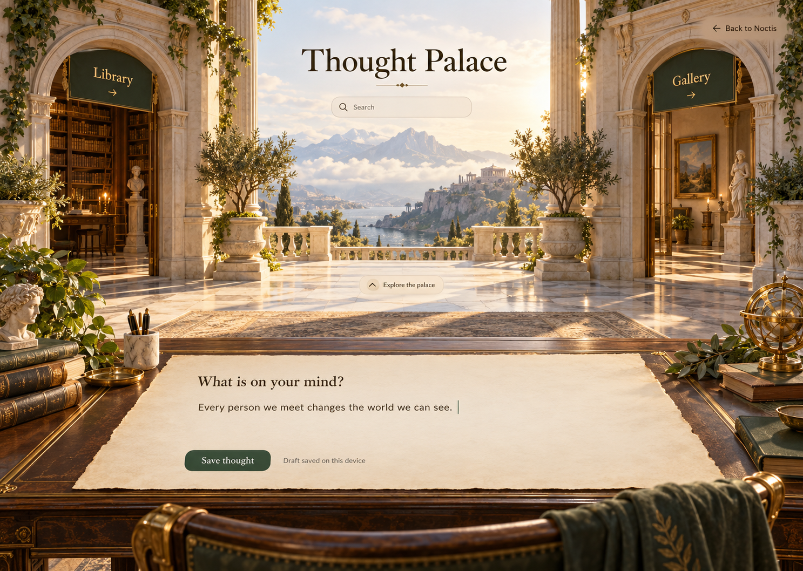
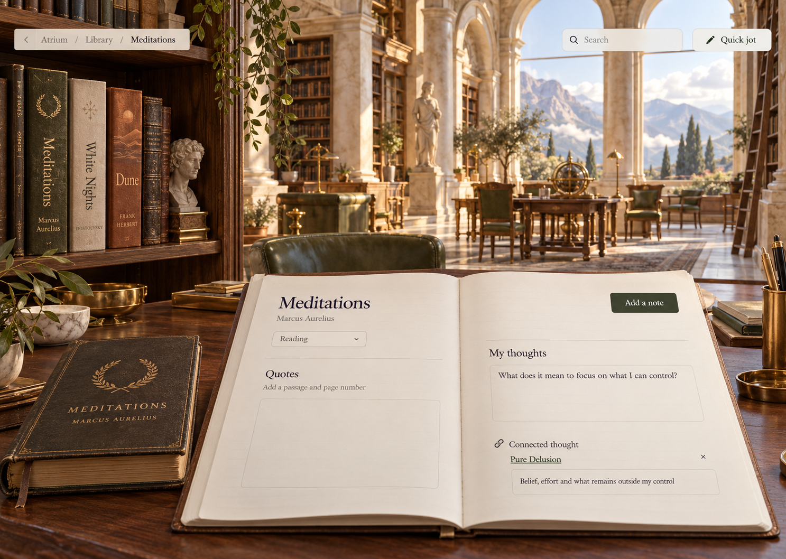
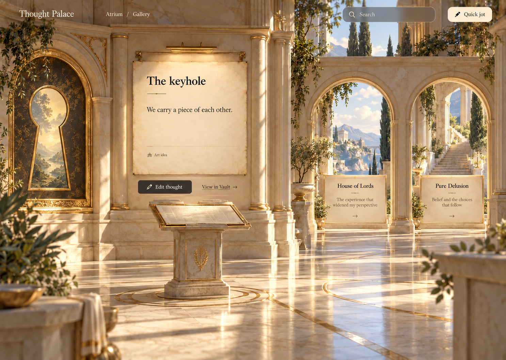
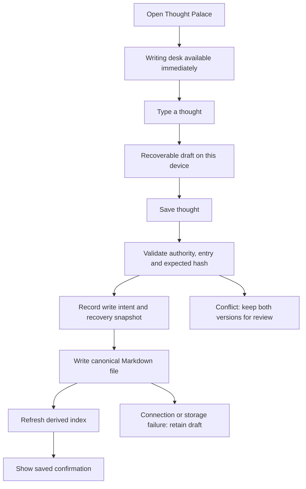

# Thought Palace: structure and implementation plan

Status: atrium visual direction selected on 28 October 2026. Implementation logic remains a review draft. The palace has not been implemented and the owner's notes have not been imported.

## Continuation handoff

The owner selected the atrium mockup below and requested fluid animations and movement. Use `docs/Mockups/thought-palace/atrium.png` as the full-resolution visual target. The exact selection screenshot is preserved as `docs/Mockups/thought-palace/selected-atrium-reference.png`. The library and gallery images remain supporting concepts to refine in the selected style.

Continue from this document when the owner resumes the work. Preserve the selected composition: immediate foreground writing, architectural doors into the library and gallery, warm stone, restrained gold and the open mountain view. Build real editable controls above scene art. Keep movement fluid, interruptible and compatible with reduced-motion preferences, with writing available throughout loading and transitions.

The next step is to review the implementation logic with the owner, then build against fixture data. The original full notes are still in the originating conversation; this document contains their import outline rather than a verbatim source archive. Obtain a private source snapshot before preparing the real import. Do not enable live writes, import notes or deploy as part of an automatic continuation.

## The experience

Thought Palace is a dedicated, explorable writing space inside Noctis. Its architecture has the warmth and grandeur of an ancient palace inspired by Olympus. Opening it gives immediate access to a writing desk. Books, earlier writing and connections live beyond that desk in rooms the owner can explore.

The owner reads physical books. A book in the palace opens a companion notebook for passages, page references and personal responses.

The first release has an atrium, a library and a gallery. Doors, shelves and exhibits are working navigation. Each destination also has a readable, keyboard-accessible control. A direct route to an entry opens that entry; ordinary entry into the palace opens the writing desk.

## Mockups

These images explore different rooms in the same palace. They show the intended atmosphere and hierarchy. They are static concept images; labels and interaction details still need implementation and browser testing.

### The atrium: capture first

The writing surface is available before scene assets finish loading. The palace opens around it. Writing requires no title or classification. Library and Gallery are visible destinations. The architectural richness stays outside the main reading area.

### The library: physical-book companions

Choosing a spine opens that book's notebook. Quotes, personal responses and connected entries remain distinct. The mockup's reading status and sample response are illustrative, rather than claims about the owner's progress or reading history.

### The gallery: follow an idea

An entry has a readable foreground surface. Nearby connected entries occupy adjacent exhibits or doorways. Following a connection changes the selected entry and preserves a route back. The relationships in the image are proposals for review.

## Information structure

Every saved item is an entry. An entry can be short, unfinished or long. Classification can happen after capture.

| Kind     | Contents                                                         | Examples from the supplied material                      |
| -------- | ---------------------------------------------------------------- | -------------------------------------------------------- |
| Thought  | The owner's reflection, question or observation                  | Ambition, luck and repetition, individual trajectories   |
| Book     | Book identity, reading status and optional edition details       | Meditations, Dune, White Nights                          |
| Quote    | A passage copied by the owner, with source and optional location | A favourite passage linked to its book                   |
| Art idea | A creative concept and its working material                      | The keyhole, pieces of other people, changing with light |
| Letter   | Long-form personal writing with its drafts kept together         | The letter to the owner's nephew                         |

A quick jot starts as a thought. Its body is required; a title can be supplied later. Before that, the interface displays a short preview as its label. That preview is presentation, rather than an invented title written into the original text.

An entry's kind can change without changing its identity or losing its links. No minimum length, completed status or required theme is imposed on personal writing.

Themes are optional tags, such as perspective, faith, ambition or connection. They filter the collection. They become links to wider Vault topics only when the owner chooses an actual target.

Rooms are views of the collection. Moving an entry between views changes its presentation or kind; it does not create another copy of its text.

## Books and quotes

A book has a stable identity, title, optional author, optional edition or translation, and a reading status: planned, reading, paused or finished. An optional reading lane distinguishes the main list from books read alongside it. Page counts, ratings and reading streaks are outside the first release.

The supplied list contains 21 titles: 16 in the main list and five alongside it. All start as planned until the owner supplies progress. Preserve the supplied wording for titles whose exact identity is uncertain, including Wired differently and Emotional alchemy. Missing authors remain blank. Metadata lookup and covers can be added after identity has been confirmed.

A thought or art idea can optionally reference a book. A quote must reference a book and retains its copied passage verbatim. Its location is free text, allowing a page, chapter, section or multiple references. Page information belongs to the recorded edition; it is never inferred from another edition.

The quote entry's body holds the passage. The owner's response is a separate thought linked to that quote. The notebook presents them together, with clear attribution. This avoids mixing someone else's words into the owner's prose. A passage with uncertain attribution can remain an ordinary thought until its source is resolved.

Deleting a book permanently is outside the first release. Archiving hides it from the active shelf while preserving every quote and reference.

## Connections

Explicit links belong to the source entry. Backlinks are calculated from those links and never saved as a second relationship that can drift out of sync.

The initial relationship vocabulary is related, inspired by and responds to. A link can have a short reason. Book membership and quote attribution use their dedicated source fields, rather than an ambiguous related link.

| Proposed connection                                      | Meaning                                                       |
| -------------------------------------------------------- | ------------------------------------------------------------- |
| The keyhole is inspired by the House of Lords reflection | An experience informed a creative concept                     |
| Pieces of other people is related to The keyhole         | Both explore growth through connection                        |
| A later reflection responds to Pure Delusion             | Beliefs can develop, qualify or disagree with earlier writing |
| A thought references Meditations                         | The book informed a personal response                         |

These connections are examples for review. The import must not silently accept them as the owner's decisions.

Adding or removing a relationship updates only the source entry. A backlink appears or disappears after the derived index refreshes. A missing target is shown as unavailable; the source text and link are retained. An ambiguous name requires a target selection.

Suggested connections are kept outside the saved entry until accepted. The first release offers explicit links and search. Semantic suggestions are a later opt-in feature using an already authorised subscription route. They can propose a reason and evidence; deterministic validation owns the actual change. No background service or separately billed provider is introduced.

The gallery initially shows a selected entry and up to four direct connections. Additional connections remain accessible through a list. It never spreads the entire Vault across the room. Shared tags can help discovery, but they are not displayed as an accepted explicit relationship.

## One original, shared with the Vault

### Recommended storage

Use Markdown files as the saved authority, consistent with the Vault. Each palace entry lives at `palace/entries/<entry-id>.md` beneath the configured Vault root. The filename and entry ID remain stable when the title changes. Existing Notes stays intact as a separate general-purpose capture tool.

The palace and the Vault read the same saved file. SQLite stores a rebuildable index, relationship projections and write receipts. Browser recovery drafts and revision snapshots are labelled recovery material. They do not become a competing current version.

The alternatives considered were extending database-backed Notes and keeping separate palace copies synchronised to Vault files. Extending Notes would be a smaller first screen, but would require an additional authority decision for Vault integration. Maintaining two editable copies adds conflict and recovery work. File authority fits the existing Vault and the owner's use of Obsidian.

### Entry representation

| Field               | Rule                                                                                                  |
| ------------------- | ----------------------------------------------------------------------------------------------------- |
| ID                  | UUID, created once                                                                                    |
| Kind                | thought, book, quote, art or letter                                                                   |
| Title               | Optional for a jot; required for a book                                                               |
| Body                | Markdown; the original writing or copied passage                                                      |
| Created and updated | Actual capture and save times, stored as ISO timestamps                                               |
| Tags                | Optional owner-editable strings                                                                       |
| Sensitive           | Uses the existing Vault sensitivity convention                                                        |
| Archived            | Hidden from the ordinary shelf or gallery, still recoverable                                          |
| Book ID             | Required for a quote, optional for a thought or art entry                                             |
| Location            | Optional source location for a quote                                                                  |
| Book details        | Author, edition, reading status and reading lane, only on books                                       |
| Connections         | Read from explicit links in the entry's Connections section; target, relationship and optional reason |
| Import origin       | Source capture ID, source section and import receipt, when imported                                   |

Use a small versioned JSON object in a delimited `noctis:palace` block for structured palace fields such as kind, timestamps, reading status and location. Keep a normal frontmatter title, sensitivity flag and UUID filename for Vault compatibility. Human prose stays outside the metadata block. The palace parser validates the block rather than extending the existing limited frontmatter reader into a general YAML implementation.

An owner-approved connection has a visible Markdown link with an explanation in a delimited Connections section. Palace-to-palace targets use the stable UUID filename with a readable label, such as `[[<entry-id>|The keyhole]]`. Each line starts with Related, Inspired by, Responds to or Book, followed by its target and optional reason. The parser reads the typed connections and book ID from these lines; the JSON metadata does not duplicate them. Unclassified additional body wikilinks remain ordinary related links. Unknown or malformed lines inside the palace-owned section are shown for repair without changing their bytes.

The implementation must save metadata, the owned Connections section and prose in one deterministic serialization operation. It must preserve unknown surrounding text and refuse malformed or duplicate metadata blocks. It must never reconstruct the entry by stripping out text it does not understand. Import preserves the full source separately and escapes any source text that could impersonate an owned delimiter.

For a connection to an existing wider Vault note, persist its selected canonical wikilink target and source path as provenance. Vault database entity IDs are derived references and must not be the only saved target. A later missing or ambiguous target is retained for repair. Palace-to-palace references retain their UUID identity.

### Identity needs targeted work

The current Vault index chooses a canonical key from the title before the filename. A UUID filename alone therefore does not prevent two entries with the same title from colliding. Palace-owned files need ID-based canonical keys. Their display titles stay readable, and title search can return several distinct entries.

Palace target selection always resolves a unique ID. Title aliases must not silently merge entries or capture an existing person or book with a matching name. Preserve current identity behaviour for existing non-palace notes. Prove same-title entries, title changes, duplicate IDs and unresolved targets with tests before exposing the feature.

Palace entries can use the existing Vault entity type `note`. Their richer kind belongs to palace metadata, so this work does not require changing every graph consumer's type enum.

## Capture and save behaviour

Saving an ordinary jot requires only its text. Capture does not wait for a model, link suggestions, indexing or palace animation. Title, kind and connections can be changed later.

Keep a browser recovery draft after a short idle delay and on navigation. Use IndexedDB through a small palace-specific module, scoped to the signed-in owner, core origin and entry or draft ID. Catch quota and access failures. The interface says Draft saved on this device only after the local write succeeds. The term Saved is reserved for a confirmed canonical file write. Logout clears that owner's recovery cache through the existing logout flow.

Sensitive entries have memory-only drafts while unlocked. Show that device recovery is unavailable for that entry. Before manual locking or logout, offer Save or Discard for unsaved sensitive writing. Session expiry clears sensitive in-memory content, so unsaved sensitive writing can be lost in that case. No plaintext sensitive draft is stored in IndexedDB. Adding encrypted recovery would be a separate change.

An unavailable core leaves a clearly labelled local draft. Retrying reuses the same entry and idempotency IDs. A second click or network retry must not create another thought. The app must not promise guaranteed recovery if the browser clears its storage.

Existing entries carry the hash read from disk. A stale edit is refused and offers the local version beside the current saved version. No automatic last-writer-wins behaviour. Noctis serialises writes per entry. External editors and OneDrive can still create conflicts; a hash check followed by a filesystem rename is not a global cross-process lock.

Use a durable write journal containing the command ID, target ID, before hash, after hash, previous snapshot and intended bytes. After a crash, an existing after hash finalises the same receipt; an unchanged before hash allows safe retry; any other state becomes a conflict. A file write and a SQLite transaction must not be presented as one atomic transaction. The entry is saved when its file is confirmed; delayed index work is reported separately and is recoverable through reindexing.

For a lost response, the UI keeps its draft until it receives the command receipt. An archived entry can be restored. Permanent deletion and an automatic draft submission queue are outside this release.

## Spatial interaction and visual implementation

Build the first palace as illustrated rooms with depth layers and deterministic camera stops. Doors transition between rooms; shelves open book notebooks; gallery exhibits open entries. This is spatial navigation with a fixed map, implemented using existing React and motion dependencies. Free walking, game physics and a new 3D engine are outside the first release.

Every visible hotspot is an actual HTML button or link anchored to the scene. The art contains no functional text. Focus rings, labels and touch targets sit above the art. A textual route provides the same destinations when images are unavailable or a screen reader is in use.

The mockups are visual targets, rather than backgrounds to ship with labels baked in. Produce separate scene art and implement text, notebooks and controls as accessible elements. Use an appropriately licensed local serif face with system serif fallback; keep body controls legible. No external font fetch is required to start writing.

Use local room state: room, selected entry, shelf page and previous selection. Returning from an entry restores its shelf position. Returning from the Vault restores the selected entry and open draft. New capture is always one action away. Opening the palace normally still lands at the desk.

Room geometry is fixed. A book's position follows an explicit stable shelf order, rather than random placement. Large collections page within that room; adding a book does not rebuild the palace. Search opens matching entries directly. Filtered shelves show that a filter is active.

Motion is interruptible and short. Reduced-motion preferences replace camera travel with immediate changes. The editor stays fixed while typing. On phones, stage a closer view of the same room with full-width writing and large controls. Touch scrolling cannot accidentally move the camera. Desktop and phone layouts need separate compositions; shrinking the desktop painting is insufficient.

Load the writing controls first, the active room next and adjacent rooms later. Idle scenes have no continuous render loop. Changing the palace's theme must remain scoped to its subtree so the rest of Noctis keeps its current design.

## Privacy, authority and assistant access

The owner can write through the authenticated palace interface after the feature and its write scope are enabled. A runtime or model-provided actor field cannot grant that authority. Reuse verified session, origin and command-authority checks. Existing-note changes proposed by assistants retain the owner's approval boundary.

Development and previews use a fixture root. Live Vault connection, live writes, deployment and import are separate owner-authorised actions. This plan does not enable existing global switches or broaden the promoter's allowed folders.

Sensitive entries must be hidden consistently from shelves, search, graph labels, backlinks, direct reads and assistant recall while locked. Concealing the body while leaking a title or relation would fail this requirement. The letter's sensitivity is a choice for the owner during import.

Store palace writing outside `inbox/` so it is not automatically fed into the existing inbox promoter. No new scheduled semantic extraction is introduced. Any later assistant recall of a palace entry must identify it as the owner's reflection or an attributed quote, include source context, and obey sensitivity checks. It must never turn a quote into the owner's belief or a reflection into a verified universal fact.

## Import of the supplied notes

Import happens after the owner reviews both the implementation and a concrete import preview. Preserve the source in a private staging location under the owner's selected shared folder. Personal source notes and full letters stay outside the source repository.

The preview is built from the owner's pasted notes only. Automatically injected MindVault lookup excerpts are not source notes for this import.

| Supplied material                   | Proposed destination                                                     |
| ----------------------------------- | ------------------------------------------------------------------------ |
| House of Lords account              | One reflection preserving the event account and its personal conclusions |
| Pure Delusion and luck              | Separate thoughts, with suggested links for review                       |
| Digitalising everything             | One short unfinished thought                                             |
| Dimensions and where effort goes    | One thought                                                              |
| Individual trajectory               | One thought                                                              |
| Letter to nephew                    | One letter containing both supplied drafts, labelled by paste order      |
| Reading list                        | 21 book entries preserving main and alongside groupings                  |
| Keyhole and pieces of other people  | Art entries preserving rough passages and the developed passage          |
| Core lore                           | One working art note preserving every supplied fragment                  |
| Art that changes with light or fire | Two short art ideas                                                      |

Titles in this table are proposed organisational labels. The owner can change the grouping before import. Similar wording is never sufficient reason to discard a draft.

Preserve Unicode, spelling, paragraph order and repetitions inside each source capture. Import time is known; original writing dates remain unknown unless supplied. Do not treat the House of Lords reflection as a dated event without an event date. The art passages' sequence shows paste order, rather than a claimed creation history.

Each imported entry records its source capture and section. A preview manifest contains source hashes, proposed entry IDs, groupings and proposed links. A repeated import of the same manifest is a no-op. Resume a partial import from its receipts without duplicating entries. A later revised source requires a new preview and must not silently overwrite edits made in Noctis.

Keep the original source capture recoverable. Withdrawal of an import archives only entries created by that import and preserves later owner changes for review. Apple Notes deletion or synchronisation is outside the task.

## Implementation boundaries and files

The checked repository already has title/body Notes, guarded file writes, Vault indexing, explicit wikilinks, sensitivity filtering, page panels, navigation history and async action feedback. It does not currently have palace entry types, a book notebook or a palace page.

| Area             | Proposed files and responsibility                                                                                                                                                                                                         |
| ---------------- | ----------------------------------------------------------------------------------------------------------------------------------------------------------------------------------------------------------------------------------------- |
| Contract         | Create `packages/contracts/src/palace.ts` and its tests; export through `packages/contracts/src/index.ts`. Define entry, read, save, archive, restore and import-preview shapes with bounds.                                              |
| Parsing          | Create `packages/domain/src/palace/entry.ts` and tests; export through `packages/domain/src/index.ts`. Parse and serialize the palace-owned format without rewriting unrelated prose.                                                     |
| Vault identity   | Modify `packages/domain/src/vault/markdown.ts` and `apps/core/src/vault/indexer.ts` with palace-only stable identity support and focused tests.                                                                                           |
| File service     | Create `apps/core/src/palace/service.ts` and integration tests. Reuse guarded write and root primitives; add palace scope checks, journaling and index reconciliation.                                                                    |
| Persistence      | Add the next numbered migration at implementation time for write receipts and recoverable snapshots. Never renumber or alter existing migrations.                                                                                         |
| HTTP             | Extend `apps/core/src/api/http.ts` with reads and command handlers; add `apps/core/src/api/palace.integration.test.ts`. Reuse the existing transport and session rules.                                                                   |
| Navigation       | Add Thought Palace to `packages/ui/src/primitives/rail-items.ts`, its navigation controls and tests, `apps/web/src/App.tsx`, and `apps/web/src/navigation/back.ts`.                                                                       |
| Panels           | Extend `packages/contracts/src/surface-payloads.ts` and tests for the new page and valid focus IDs. Use the existing page renderer and restore mechanism.                                                                                 |
| Writing UI       | Create `apps/web/src/pages/ThoughtPalace.tsx` and `apps/web/src/palace/` modules for room view, entry editor, book notebook, scoped styles and draft recovery. Reuse ActionButton, motion preferences, Markdown and back-layer behaviour. |
| Preview fixtures | Add palace data and handlers under `apps/web/src/larp/`, and a small private-free fixture collection under `packages/test-kit/src/`.                                                                                                      |
| Visual assets    | Put selected scene assets under `apps/web/public/palace/` after visual review. Keep these planning mockups in `docs/Mockups/thought-palace/`.                                                                                             |
| Browser evidence | Add `apps/web/e2e/palace.test.mjs` using the existing browser test pattern. Exercise mouse, keyboard and phone interactions with fixture data.                                                                                            |

The new subsystem should not expand the already large Productivity page. No donor code is needed. No dependency installation or lockfile change is part of the current artifact work.

## Proposed service contract

Use the existing authenticated HTTP transport and command convention. Shared Zod contracts are the interface authority. There is no existing local Postman collection or OpenAPI artifact identified for this feature, and this planning task does not justify creating a second contract source or binding a remote workspace.

| Operation          | Proposed interface                                                              | Consequence                                                                                |
| ------------------ | ------------------------------------------------------------------------------- | ------------------------------------------------------------------------------------------ |
| Browse or search   | `GET /palace/entries` with query, kind, book, archive filter and bounded cursor | Returns visible entry summaries and next cursor                                            |
| Read               | `GET /palace/entries/:id`                                                       | Returns parsed entry and current content hash                                              |
| Save               | `POST /commands/palace.save`                                                    | Creates or updates one canonical file                                                      |
| Archive or restore | `POST /commands/palace.archive` and `palace.restore`                            | Changes visibility with a recoverable write                                                |
| Preview import     | `POST /palace/import-preview`                                                   | Validates a supplied capture and returns a proposed manifest; no canonical entries written |
| Apply import       | `POST /commands/palace.import`                                                  | Applies the reviewed manifest with per-entry receipts                                      |

The save request carries an entry ID, idempotency key, expected content hash for updates and validated entry contents. New entries require absence of an existing file. The server resolves the path from the ID; callers never supply an arbitrary filesystem path. Existing entries cannot be overwritten by a create request.

Success returns the entry ID, resulting hash and the existing command receipt shape. Index status is a separate field. Replaying a command returns its original receipt; reusing a key with changed content is refused. A hash mismatch returns the existing conflict form, with the draft retained in the client. Missing, locked, disabled or malformed entries receive explicit errors without returning hidden titles or text.

Use existing request-size limits, UUID and hash schemas, origin checks and error envelopes. Entry bodies have a 100,000-character bound consistent with existing Notes. Connection counts, tag lengths and import total bytes are bounded in the shared schema and tested before file access. Browsing uses a maximum page size of 200 and filters hidden entries before pagination. No endpoint claims a file is saved before confirmation from disk.

## Delivery sequence and verification

Every behavioural slice starts with a focused failing test, verifies that failure, implements the smallest passing change, and records the successful check. The following is an implementation sequence for review, rather than permission to execute it now.

### 1. Entry format and stable identity

- [ ] Define the shared schema and deterministic file format.
- [ ] Prove a title change preserves identity and two equal titles remain distinct in the Vault.
- [ ] Prove duplicate IDs, malformed metadata, invalid quote attribution and malformed connection sections are refused without modifying source bytes.
- [ ] Prove original prose, Unicode, unknown surrounding sections and two letter drafts survive read/write cycles.

### 2. Save, recovery and authority

- [ ] Implement the scoped service and durable write receipts in a fixture root.
- [ ] Prove duplicate submission creates one file and a lost response can be safely retried.
- [ ] Prove a stale update preserves both versions and an archived entry can be restored.
- [ ] Test interruption before file write, after file write and before index refresh; recovery must reach the same receipt or an explicit conflict.
- [ ] Prove traversal, Windows junction escapes, locked sensitive reads and runtime-supplied authority claims are refused.
- [ ] Register authenticated reads and commands with contract tests before UI integration.

### 3. Immediate writing

- [ ] Add the dedicated page and its page-panel entry.
- [ ] Implement local draft recovery, visible save states and duplicate-click prevention.
- [ ] Test typing before scene assets load, reload recovery, failed local storage, unavailable core and navigation with an unsaved draft.
- [ ] Verify returning from the Vault restores the selected entry and draft.

### 4. Library and gallery

- [ ] Add book notebooks, quotes, explicit relationships and calculated backlinks.
- [ ] Test book archival with attached quotes, edition-specific locations and quote attribution in display and recall.
- [ ] Test removing a link removes the backlink after refresh; missing targets preserve the source.
- [ ] Test bounded related-entry displays and stable shelf pagination with a growing collection.

### 5. Palace scenes and accessibility

- [ ] Use the reviewed visual target to build scene layers and anchored navigation.
- [ ] Verify working doors, shelves and exhibits, with the same destinations accessible by keyboard.
- [ ] Capture desktop and phone evidence of capture, book notebook, gallery, failed save, conflict and recovery.
- [ ] Verify reduced motion, text contrast, zoom, touch targets, focus return and content access when artwork fails to load.
- [ ] Measure the time until the editor accepts typing with delayed images; use a provisional target of one second on the work PC, independent of room-art completion.

### 6. Import preview and controlled rollout

- [ ] Implement source-preserving import preview, reviewed grouping and repeatable receipts.
- [ ] Verify all 21 supplied book titles are retained, unknown metadata stays unknown and both letter drafts survive.
- [ ] Prove injected lookup context is excluded and partial imports resume without duplicates.
- [ ] Present the exact import manifest and target scope to the owner before writing real notes.
- [ ] Enable live use and deployment only within the owner's explicit authorisation for those actions.

During implementation, use Node.js 22.23.2 and the existing lockfile. Run focused Vitest suites as each slice changes, then typecheck, lint and the web build. Run the palace browser test against fixtures and inspect desktop and phone evidence. Broaden regression checks when contract, navigation or Vault identity changes justify them.

## Acceptance and remaining choices

The feature is ready for use when capture works before art loading, saved entries survive restart, books keep attribution, connections lead to the intended original, and the same content is navigable through the Vault. Failed saves and conflicts preserve writing, and locked entries remain absent from every route that could reveal them.

The owner has selected the atrium's visual direction with fluid animation and movement. The fixed-room spatial approach, exact book-notebook layout and implementation logic remain for review before production code. Live write scope is a separate approval. Import grouping and the letter's sensitivity are reviewed at the import stage.

Free walking, a large 3D world, reading the actual book inside Noctis, automatic semantic extraction, new paid services, cover scraping and permanent deletion are excluded from this first release.

## Evidence for this planning draft

The current Notes contract and service, Vault Markdown parser and indexer, guarded write helper, inbox promoter, page-panel contract, app navigation and installed web dependencies were read on 28 October 2026. These checks informed the file authority, title-collision work and reuse boundaries above.

Artifact verification passed: Prettier formatting, all three relative image links, PNG signatures and dimensions, required document sections, whitespace and placeholder checks. The final gallery image includes a corrected passage. Repository status shows only this new plan and its mockup folder from the current work.

No production behaviour, schema migration, live Vault connection, note import or deployment was performed. The mockups are static; interaction, performance and accessibility claims remain acceptance targets for implementation.
